# uts_web_1
# 📚 APLIKASI TOKOBUKU
### Ujian Tengah Semester – Praktikum Pemrograman Web 1

##  Identitas
- **Nama:** Isnaini
- **NIM:** 312510380
- **Mata Kuliah:** Pemrograman Web 1
- **Tahun:** 2026

---

##  Deskripsi Project

TokoBuku merupakan aplikasi berbasis web sederhana yang dibuat untuk memenuhi tugas Ujian Tengah Semester (UTS) Praktikum Pemrograman Web 1.

Aplikasi ini dibuat menggunakan HTML, CSS, dan JavaScript. TokoBuku memiliki beberapa fitur untuk melakukan simulasi pengelolaan toko buku, mulai dari login pengguna, dashboard, pengelolaan stok buku, checkout, hingga tracking pengiriman.

Project ini menggunakan data simulasi yang disimpan dalam JavaScript dan belum menggunakan database.

---

## Tujuan Project

1. Menerapkan penggunaan HTML dalam pembuatan halaman website.
2. Menggunakan CSS untuk mengatur tampilan website.
3. Menerapkan JavaScript untuk mengolah data.
4. Memahami penggunaan DOM dan Event Handling.
5. Membuat aplikasi toko buku sederhana berbasis web.

---

## Teknologi yang Digunakan

| Teknologi | Kegunaan |
|---|---|
| HTML | Membuat struktur halaman website |
| CSS | Mengatur tampilan dan desain website |
| JavaScript | Mengolah data dan interaksi pengguna |
| Visual Studio Code | Menulis dan mengedit kode program |
| Google Chrome | Menjalankan dan menguji aplikasi |

---

##  Fitur Aplikasi

### 1. Login
Digunakan untuk melakukan simulasi masuk ke dalam aplikasi menggunakan email dan password.
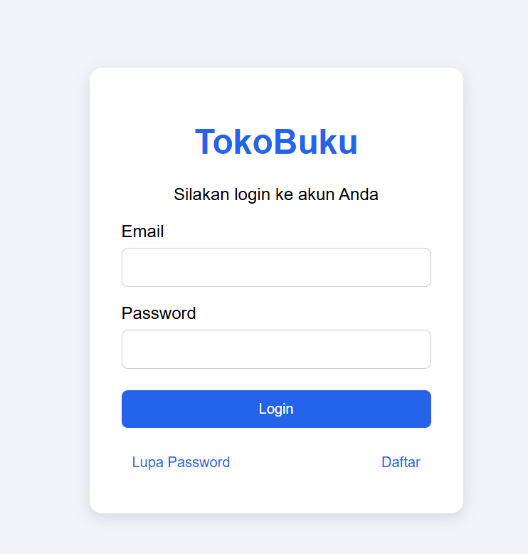
di fitur login ini juga menampilkan seperti lupa password 
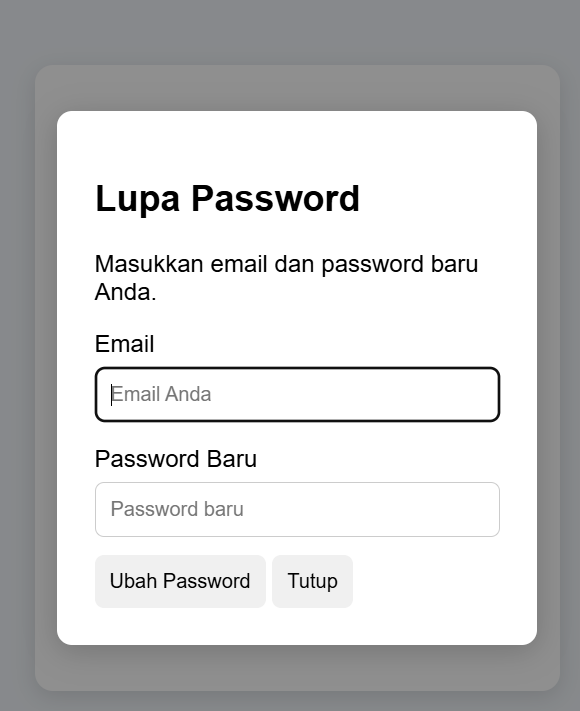

dan daftar akun
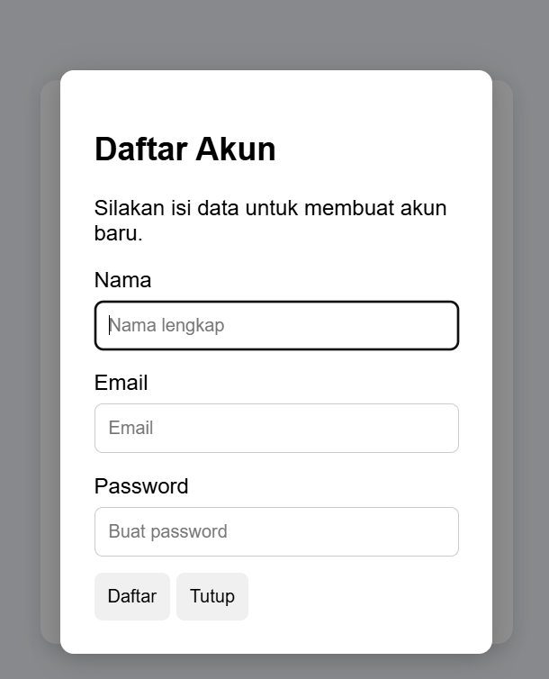
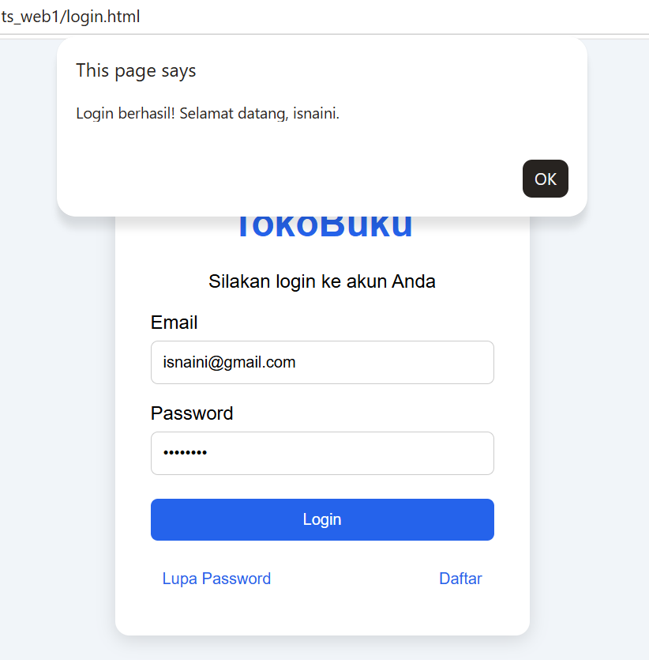

### 2. Dashboard
Menampilkan halaman utama dan navigasi menuju fitur-fitur aplikasi.
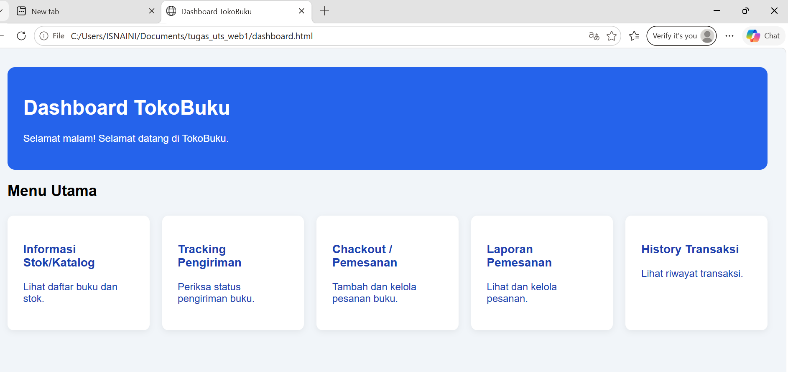

### 3. Stok/Katalog Buku
Menampilkan daftar buku dalam bentuk tabel yang berisi:
- Foto buku
- Kode barang
- Nama barang
- Jenis barang
- Edisi
- Stok
- Harga
  
  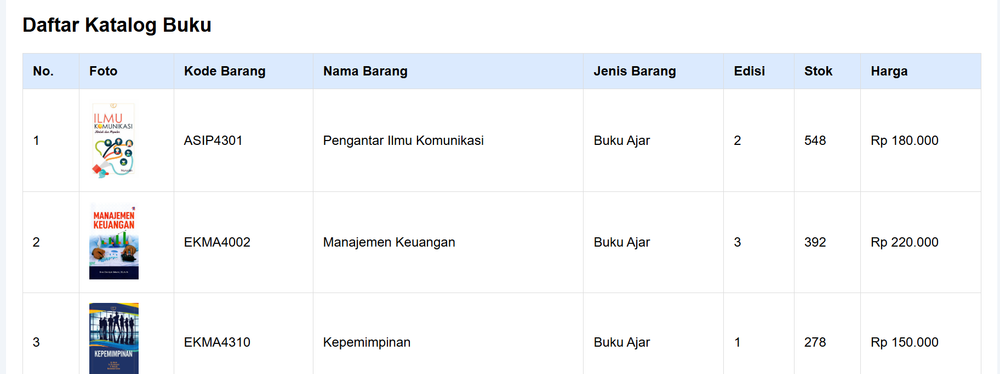
  

### 4. Tambah Buku
Digunakan untuk menambahkan data buku baru melalui form yang tersedia.
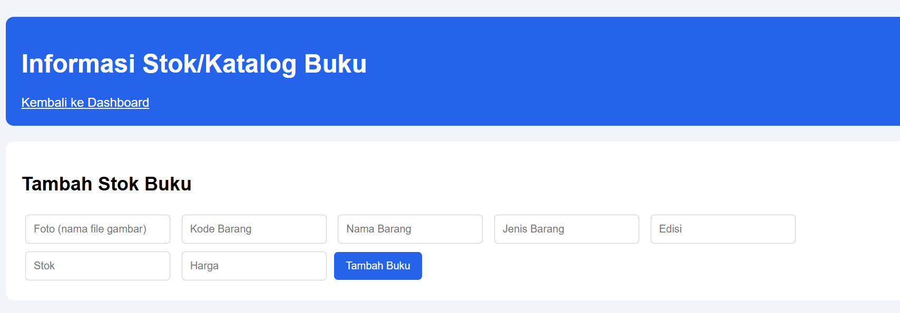

### 5. Checkout
Digunakan untuk melakukan simulasi proses pemesanan buku.
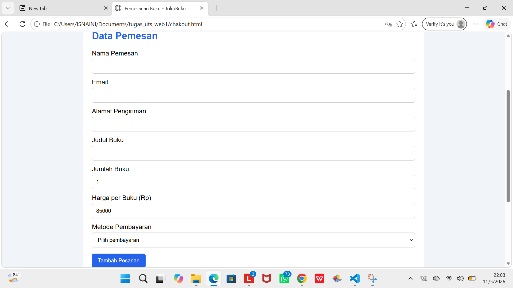
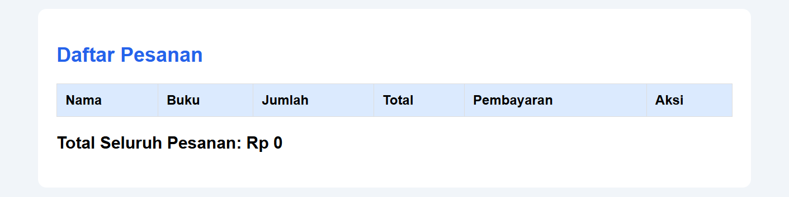
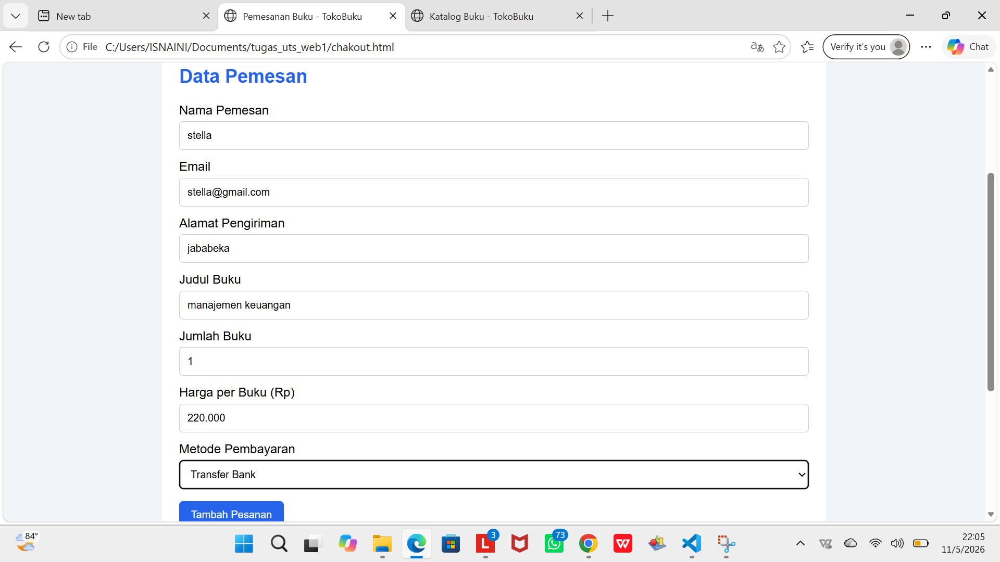

dan juga ada fitur untuk tambah pesanan
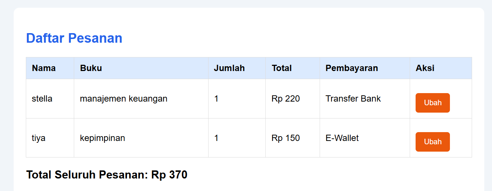

lalu pesanan berhasil dan mendapat no DO (no pesanan)
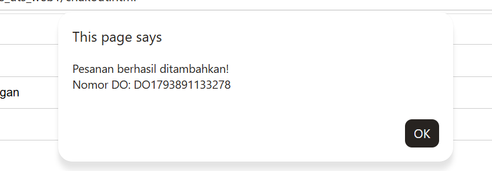

### 6. Tracking
Digunakan untuk melihat informasi dan status pengiriman pesanan.
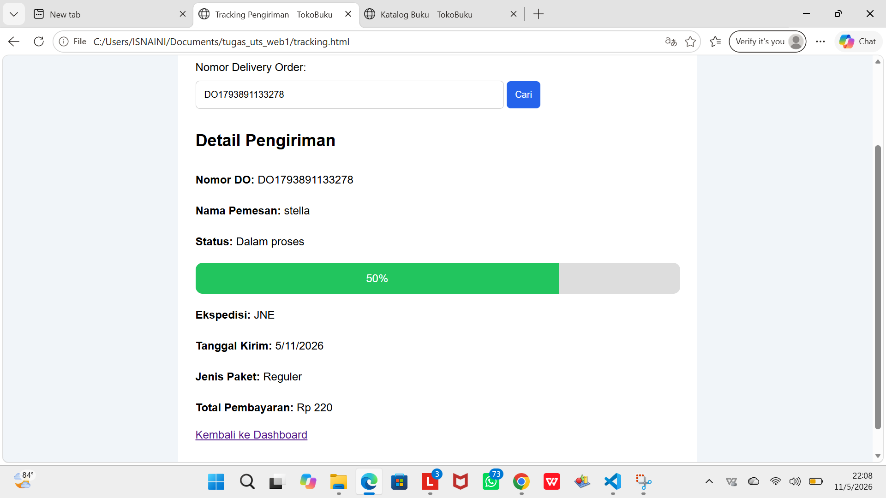

### 7. Laporan dan History
Merupakan halaman pendukung untuk melengkapi fitur aplikasi.
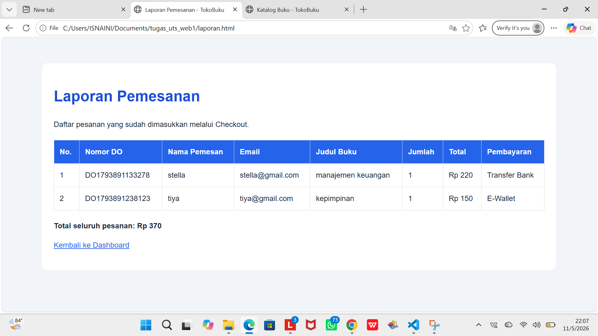
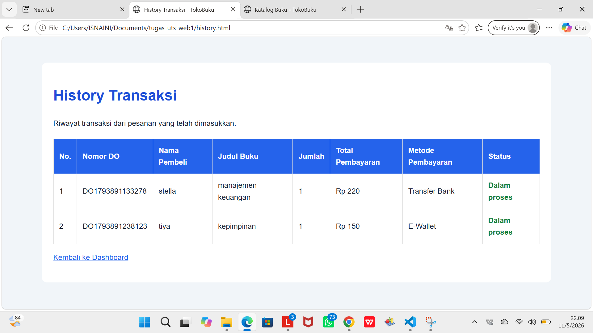

---

##  Struktur Folder Project

```text
tugas_uts_web1/
│
├── login.html
├── dashboard.html
├── stok.html
├── checkout.html
├── tracking.html
├── laporan.html
├── history.html
│
├── css/
│   └── style.css
│
├── js/
│   ├── data.js
│   └── script.js
│
└── img/
    └── gambar-buku
```

*Catatan: Struktur folder dapat disesuaikan dengan file yang benar-benar terdapat di dalam repository.*

---

##  Cara Menjalankan Aplikasi

1. Download atau clone repository ini.
2. Ekstrak folder project jika masih berbentuk ZIP.
3. Buka folder project menggunakan Visual Studio Code.
4. Pastikan seluruh file HTML, CSS, JavaScript, dan gambar berada di folder yang sesuai.
5. Buka file `login.html` menggunakan Google Chrome.
6. Aplikasi TokoBuku siap dijalankan.

---

##  Pengujian Aplikasi

Pengujian dilakukan dengan mencoba fitur-fitur yang tersedia, yaitu:

- Membuka halaman login.
- Memeriksa proses login pengguna.
- Membuka dashboard.
- Melihat daftar katalog dan stok buku.
- Mencoba menambahkan data buku.
- Membuka halaman checkout.
- Melihat informasi tracking pengiriman.
- Membuka halaman laporan dan history.

Hasil pengujian disesuaikan dengan fungsi aplikasi yang telah dijalankan.

---

##  Kesimpulan

Pembuatan aplikasi TokoBuku menjadi salah satu penerapan materi Praktikum Pemrograman Web 1. Melalui project ini, penggunaan HTML, CSS, dan JavaScript dapat diterapkan untuk membuat website sederhana yang memiliki beberapa halaman dan fitur interaktif.

Project ini diharapkan dapat meningkatkan pemahaman mengenai pembuatan website, pengolahan data menggunakan JavaScript, serta penggunaan DOM dan Event Handling.

---

##  Penutup

**Project UTS Praktikum Pemrograman Web 1**

Dibuat oleh **Isnaini** 
